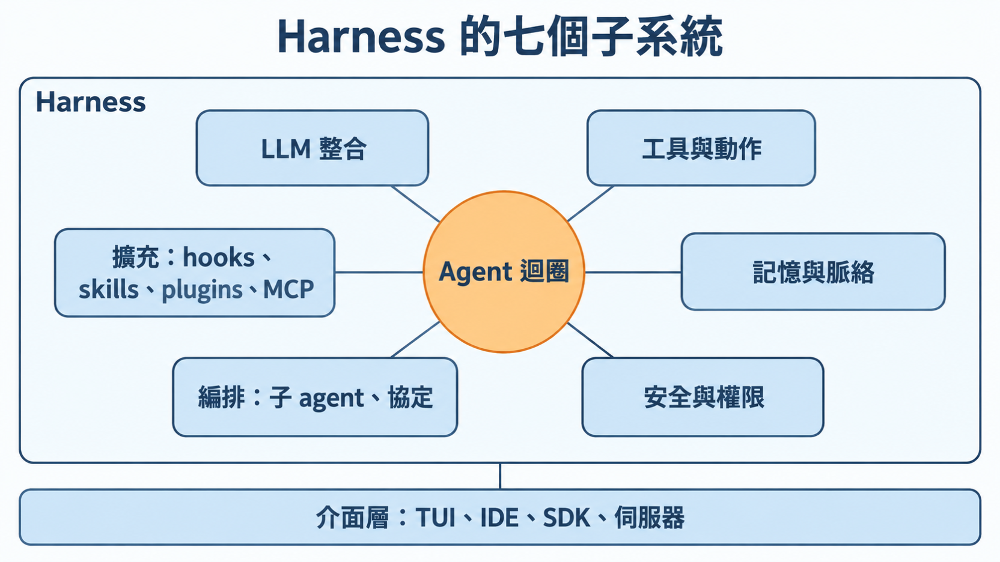
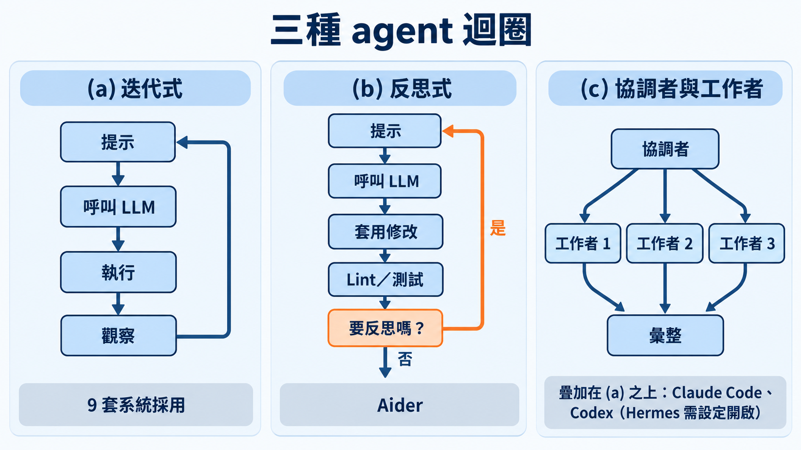
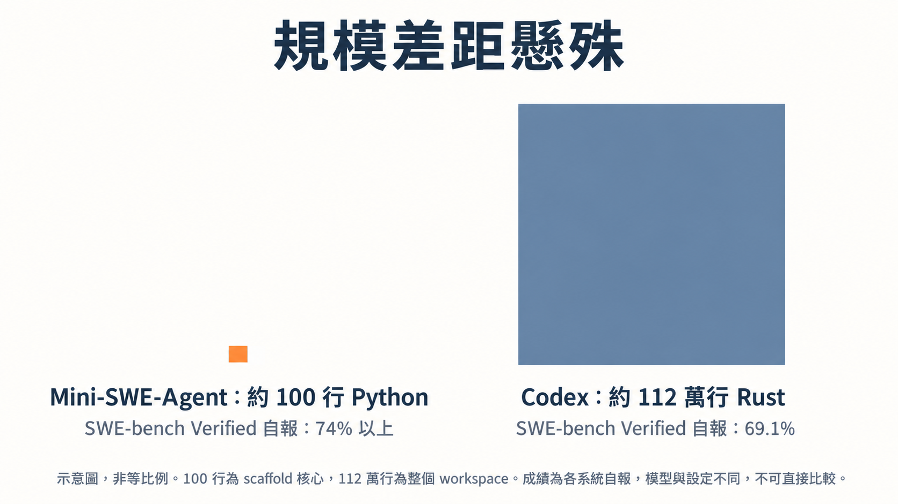
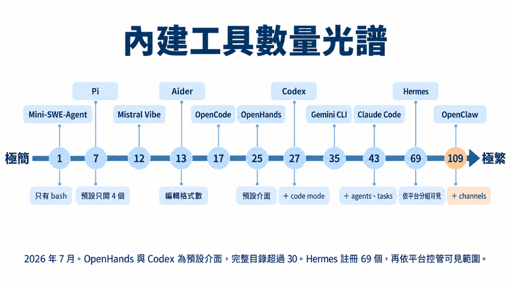
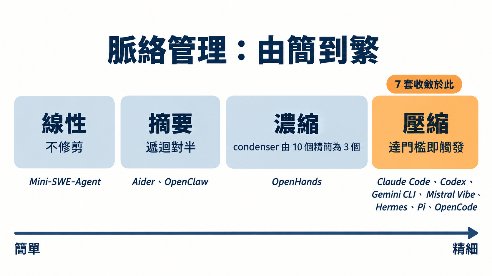
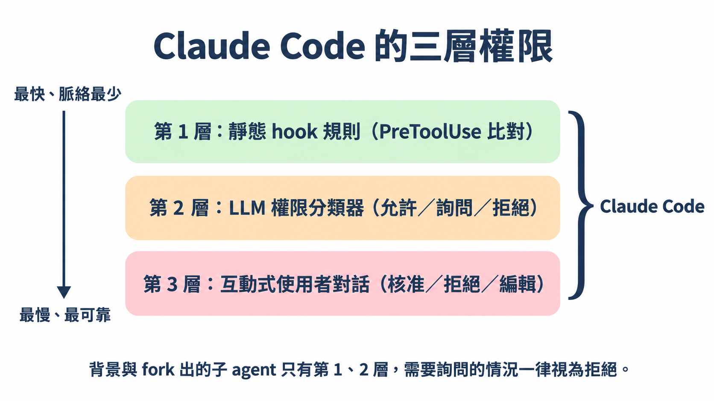
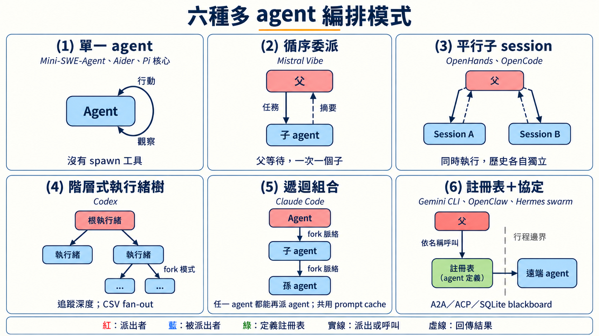
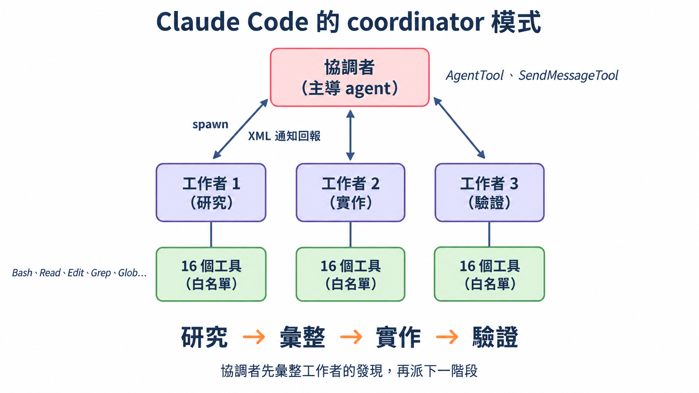
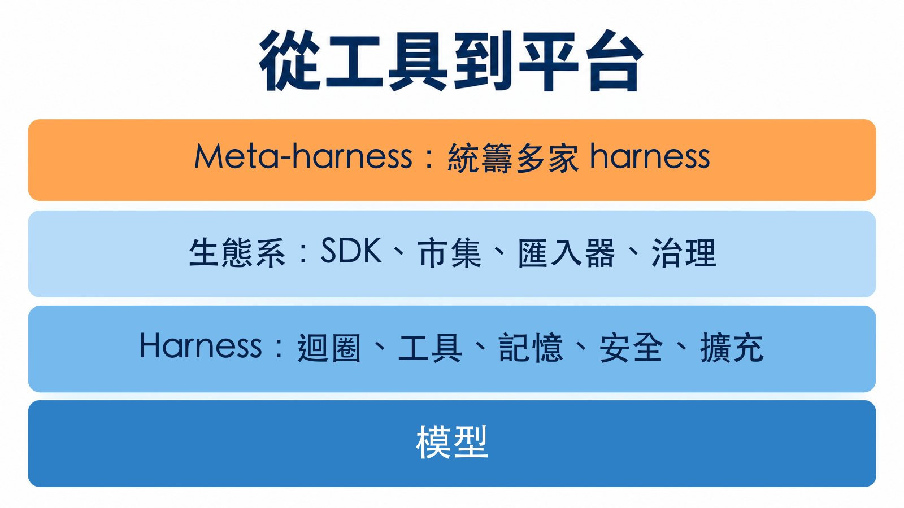

# 模型以外的一切：解剖 11 套 coding agent 的原始碼

> 一句話版本：同一個模型，裝進不同的外殼就是不同的產品。2026 年 7 月的這篇論文把 11 套正在營運的 harness（其中 1 套是非 coding 的對照）拆開來看，發現外殼的共識比想像中多，還有兩樣大家以為必備的東西，完全沒人用。

## 先問一個問題：你每天用的 agent，到底是什麼？

用 Claude Code、Codex CLI 或 Gemini CLI 寫程式時，多數人腦中的畫面是「一個很聰明的模型」。這篇論文要你換一個畫面：模型只是其中一半。

作者群沿用的定義很短：**agent ＝ 模型 ＋ harness**，這條等式由 LangChain 的 Trivedy 在 2026 年初推廣開來。Harness 就是模型以外的所有東西：迴圈怎麼跑、能呼叫哪些工具、對話內容怎麼取捨、哪些指令需要人點頭、能不能派出子 agent、怎麼外掛新功能。[這篇論文](https://arxiv.org/abs/2609.00006)就是以這個定義為起點，去拆解真實的 harness。

## 這篇論文從哪來

Harness engineering 這個詞很新。論文的說法是，2026 年 2 月它才開始流通：Mitchell Hashimoto 先在文中順口提到，LangChain 的 Trivedy 隨後把它定義並展開。接著四月有 Böckeler 寫給 coding agent 使用者的指南，六月有 O'Reilly 與獨立作者的整理，學術界也跟上，出現自動演化 harness 的研究，以及給 harness 下操作型定義的論文。論文引言形容，短短五個月，它從廠商部落格的一個用語，長成了有實務指南、正式定義與自動化系統的領域。

缺的是一份依據真實原始碼的參考。論文認為既有文獻各有缺口：benchmark 調查只報分數（多半是 SWE-Bench），不談架構；概念分類只描述模式，沒有實作對照；唯一同期的原始碼分類，把各家原廠的系統排除在外。迴圈怎麼組、工具怎麼定義與隔離、安全怎麼執行、脈絡怎麼配給，這些決定一套 harness 可不可靠、好不好擴充的工程選擇，在論文看來，既有文獻都還沒碰到。作者群因此直接讀 11 套系統的原始碼，並在引言先亮出論點：harness 已經從工具變成平台。

論文是 2026 年 7 月 15 日放上 arXiv 的預印本（cs.SE），第一作者 Paul Barbaste，作者群來自 Inclusive Brains 與 Wavestone AI Lab。它有一個四月的前一版，其中 8 套系統在七月重新取樣，所以後面才有「同一批系統，隔了一季改了什麼」的比較。

這篇導讀照論文的脈絡走：先看它怎麼切這個物件，再看最讓人意外的幾個發現，最後談你拿回去能用什麼。

## 這篇論文怎麼做的，以及它沒做什麼

先交代研究的邊界，後面的數字才讀得準。

| 項目 | 內容 |
|---|---|
| 研究對象 | 11 套 harness：Claude Code、Codex CLI、Gemini CLI、Mistral Vibe、OpenHands、Aider、Mini-SWE-Agent、Hermes、Pi、OpenCode、OpenClaw；另以 Databricks 的 Omnigent 作為「meta-harness」對照。其中 OpenClaw 是多通路的個人助理 gateway，沒有自己的改檔工具，論文把它當非 coding 的對照點，採用率的數字有時會另報排除它的 10 套版本 |
| 方法 | 讀原始碼，固定在 2026 年 7 月的版本；其中 8 套在 4 月也讀過，因此能比較一季之間的變化 |
| 規模 | 約 400 萬行 Python、TypeScript、Rust |
| 沒做的事 | 不跑 benchmark、不排名；作者明說「描述與比較怎麼建造，不比誰強」 |

兩個限制要先記著。第一，Claude Code 的分析根據的是 2026 年 3 月流傳的原始碼快照，不是官方釋出版本，作者自己也說這是可重現性最弱的一環。第二，論文引用的跑分都是各系統自己報的，模型和設定不同，作者特別聲明不做直接比較。

## 把 harness 拆成七塊

論文最實用的貢獻是一張地圖。每個系統，從最小的到最大的，都得對同樣七件事表態，哪怕表態是「刻意不做」。

| 子系統 | 管什麼 | 最小的做法 | 最大的做法 |
|---|---|---|---|
| Agent loop | 推論與動作交替，何時停 | Mini-SWE-Agent：一個 while 迴圈、一個 bash 工具 | OpenHands：事件溯源的對話引擎，可平行執行工具 |
| LLM 整合 | 跟模型供應商溝通、快取、路由 | 一次 LiteLLM 呼叫 | Hermes：五套自有傳輸層、29 個供應商設定檔 |
| 工具 | 能做什麼，尤其是怎麼改檔 | 只有 bash | Claude Code：43 個型別化工具，延遲載入 |
| 記憶與脈絡 | 配給 context window、跨 session 保存 | 無限累加歷史 | Codex：由 agent 自己維護的跨 session 記憶 |
| 安全與權限 | 什麼能跑、什麼要問、怎麼隔離 | 花費與步數上限 | Codex：規則引擎＋LLM 審核＋三平台 OS 沙盒 |
| 編排 | 派子 agent、串接其他 agent | Aider：沒有，刻意單 agent | Claude Code：遞迴組合 |
| 擴充 | hooks、skills、plugins、MCP | Python protocol | Pi：一切皆擴充 |

這張表值得多看兩眼。「最小」那一欄幾乎都是同一個名字，Mini-SWE-Agent，這引出後面的發現。

## 迴圈的三種長相

七塊裡最核心的是 agent 迴圈：模型推論與動作執行輪流進行，直到任務結束。論文指出 11 套全都是 ReAct 模式的變形，差別在複雜度、平行度和狀態管理，歸納成三種。

- **(a) 迭代式**：提示、呼叫 LLM、執行、觀察，再回到提示。9 套系統採用，包括 OpenHands、Claude Code、Codex、Gemini CLI、Mistral Vibe、Mini-SWE-Agent、Hermes、Pi 與 OpenCode。
- **(b) 反思式**：Aider 在套用修改後跑 lint 與測試，再決定要不要反思重來。Hermes 把類似的功能放進迴圈的停止條件裡。
- **(c) 協調者與工作者**：疊加在 (a) 之上，由協調者派出多個工作者，再彙整結果。Claude Code 與 Codex 有明確規範的做法，Hermes 則由設定開關控制。

另一篇同期的原始碼分類研究（Rombaut）提醒，實際上線的迴圈多半是幾種基本做法組合出來的。論文自己補了一個例子：四套廠商原生系統都提供的 plan mode，就是把先規劃再執行的做法嫁接在 ReAct 上。

迴圈外面還有一圈。OpenHands 的 `/goal` 端點會讓 LLM 評審檢查每次執行的結果，決定重送還是停止；Hermes 的 verify-on-stop 守衛可以否決迴圈自己的結束。這兩個功能存在的唯一目的，就是在內層迴圈外再套一圈。論文把這條接縫連到 2026 年 6 月出現的「loop engineering」說法：harness engineering 蓋的是內層的動作與觀察循環，loop engineering 則是從外面把它組成能自己運轉、不必每一輪都靠人下指令的外層迴圈。

## 地板很低：一百行，對一百一十萬行

論文第 2.4 節指出，Mini-SWE-Agent 用約 100 行 Python 實作了全部七個子系統：一個迴圈、一個模板、一個工具、一份訊息清單、兩個上限。它自報在 SWE-bench Verified 上拿到 74% 以上，Codex 自報 69.1%。要留意口徑：100 行是 Mini-SWE-Agent 的 scaffold 核心，整個套件約 5K 行；Codex 的 112 萬行則是整個 workspace。

先別急著下結論。作者在第 13.4 節寫得很清楚：這兩個數字用的模型、設定、有沒有沙盒都不同，「我們不從中得出直接對比的結論」。他們只拿來說明一件事：Codex 多出來的程式碼，相當大一部分沒有花在「把任務做完」的邏輯上。

那花在哪？作者的清單是：安全（跨平台沙盒）、使用體驗（終端介面、串流）、可擴充性（MCP、外掛）、穩健性。Observation 1 還給了一個很具體的例子：OpenCode 的非測試程式碼，大約五分之三是 TUI、網頁、桌面與 SDK 這些用戶端，Codex 七月的程式樹裡有「再也不會被 benchmark 量到」的即時語音層。Codex 在一季內從約 62 萬行長到約 112 萬行 Rust（126 個 crate），新增的內容包括記憶、審核機制、外掛市集、code mode 與即時語音。

論文第 15.5 節把這個現象整理成一個「還沒被驗證的直覺」：scaffold 越複雜，任務成功率的曲線大概是凹的，起初幾個結構（一個 bash 工具、一個讀寫工具、一個 Markdown 脈絡檔）讓成功率快速上升，之後再加的東西主要換來安全與體驗，對完成率的幫助有限。作者明說這是待檢驗的假說。

另一個與這個直覺相容、但不足以證實它的結果來自別人的研究：論文引用的 Lin 等人的自動演化 harness，從只有 bash 的種子出發，達到 71.9%（SWE-bench Verified），消融實驗顯示工具（+3.3 個百分點）、中介層（+2.2）、長期記憶（+5.6）有貢獻，單改 system prompt 反而下降 2.3 個百分點。這是第二手轉述，數字以原論文為準。

工具數量把這條光譜呈現得更直接。

Mini-SWE-Agent 只有 1 個 bash，Claude Code 有 43 個，Hermes 註冊了 69 個，OpenClaw 則在 109 個以上。這些數字要小心讀：Aider 的 13 是編輯格式數，不是工具數；Pi 做了 7 個，預設只開 4 個；Hermes 的 69 個會再依平台分組控管可見範圍；OpenHands 與 Codex 標的是預設介面，完整目錄都超過 30 個。論文在這方面的建議（Rec. 3、4）是先只給 bash，看到實際的失敗模式再加工具，超過約 15 個就改用延遲載入。圖上 Codex、Claude Code、OpenClaw 旁的「＋ code mode」「＋ agents、tasks」「＋ channels」，是原圖標註的額外工具類別。

## 兩個「缺席」：沒有框架，也沒有向量檢索

這是整篇最容易被拿來引用的發現。

在 11 套系統、約 400 萬行程式碼裡：

1. **沒有任何一套在 agent runtime 裡使用通用 agentic 框架**。LangChain、LangGraph、AutoGen、CrewAI 都沒有；連 Gemini CLI 也沒用 Google 自己的框架。每個迴圈都是用該語言的非同步原語手刻的。
2. **沒有任何一套用向量嵌入（embedding）檢索程式碼**。大家用的是 ripgrep、tree-sitter、glob，以及自動發現的 Markdown 脈絡檔（CLAUDE.md、AGENTS.md 之類）。

這個結果有點反直覺，因為一般 LLM 應用的主流文獻通常把 RAG 與框架當成標配。作者的解釋是複雜度預算不同：當失敗的後果是改壞真實的程式碼時，可除錯、提示詞透明的價值，勝過框架帶來的重用。

這個發現有幾個該保留的但書。第一，作者檢查的是依賴清單與 import 的 grep，重複做了兩次、相隔三個月；他們沒追蹤內部 fork、動態載入的外掛或轉譯後的發行版。邊界案例也存在：論文把 OpenCode 內層管線使用的一套 provider 抽象 SDK 稱為最接近邊界的例子。論文原話是：如果有公司在某條沒檢查到的路徑上用了 LangChain，「我們會驚訝，但不會震驚」。第二，「沒有向量檢索」限定於程式碼；OpenClaw 的預設設定對聊天紀錄用了混合嵌入，Hermes 則用 SQLite 全文檢索處理對話層級的回憶。

### 歷史怎麼解釋這件事

第 14.2 節給了一個有意思的說法：harness 沒有採用框架，是把框架取代了。證據是雙向的：Claude Agent SDK 把 Claude Code 變成可 import 的函式庫；OpenAI 在 Codex 的 repo 裡出了 SDK；另一頭，LangChain 自己做了 Deep Agents 這個 harness，結果自行採用了這群 harness 的慣例（SKILL.md、AGENTS.md、子 agent、待辦清單）。於是「該用哪個 agent 框架？」變成了「你已經在跑哪個 harness？」。

## 擴充標準塵埃落定：Skills 超車 MCP

2026 年這一季，擴充層的格局清楚了：

- **SKILL.md**：11 套中有 9 套實作（只有 Aider 與 Mini-SWE-Agent 沒有）。
- **MCP**：8 套。四月時兩者打平，Pi 採取「實作 skills、明確拒絕 MCP」的立場，讓天平傾斜。
- **ACP**（Agent Client Protocol）：6 套。它原本是編輯器與 agent 之間的協定，現在多了第三個用途：讓 OpenHands 把 Claude Code、Codex 或 Gemini CLI 當成可互換的後端來跑。

Skills 這一層也在長出生態系：四套系統有託管的 registry，Hermes 有信任分級與隔離，OpenClaw 有來源驗證，還出現了第一批由 agent 自己寫出來的 skill（Hermes 的自我改進迴圈、Gemini CLI 的擷取收件匣）。

論文的實務建議（Recommendation 14）因此是：能力模板、工作流程、領域知識交給 Skills，對外部服務的整合才用 MCP，順序也照這樣排。

## 脈絡管理：壓縮成了事實標準，差別轉到記憶怎麼寫入

Context window 有限，harness 得決定怎麼配給。論文把做法依複雜度排成四級。

- **線性**：完全不修剪，Mini-SWE-Agent 只是一直累加歷史。
- **摘要**：論文把 Aider 與 OpenClaw 歸在這一級。以 Aider 為例，歷史超過上限就依 token 數切成兩半，保留較新的一半，較舊的一半交給 LLM 摘要，必要時遞迴處理。
- **濃縮**：OpenHands 的 condenser 在 V0 有十個實作，V1 SDK 精簡成三個，作者說多數特化版本證明不必要。
- **壓縮**：token 用量達到門檻就觸發 LLM 摘要。四套廠商原生 harness 加上這一版新增的 Hermes、Pi、OpenCode，共 7 套收斂在這裡，論文稱它是事實標準。不過三套新來的各自混入了其他策略的特色，例如逐步合併摘要、可抽換的引擎、以 session 樹當基底。

壓縮既然趨同，前沿就換了地方。Observation 5 指出，現在拉開差距的是「記憶怎麼寫進去」，論文看到四種治理模型並存：

- **由 agent 自己維護**：Codex 讓沙盒內的子 agent 在有 git 基線的儲存區上整併記憶。
- **人工把關**：Gemini CLI 的擷取子 agent 把內容寫進待審收件匣，使用者用 `/memory` 審過才算數。
- **模型直接寫，但有上限**：Hermes 使用字元數受限的 Markdown 快照，每個 session 凍結一份以維持快取；OpenHands 與 Claude Code 走脈絡檔慣例。
- **回覆前先做 agentic 回想**：OpenClaw 的 Active Memory 子 agent。

另外，11 套之中沒有任何一套把嵌入式檢索當成主要的記憶基底，前面「缺席」的發現從程式碼延伸到了記憶；Hermes 的 SQLite 全文檢索，是上線系統裡最進階的做法。

## 沙盒做不做，看取捨，跟規模無關

四月版論文看到最大的兩套系統（Codex 與 Gemini CLI）恰好都有跨平台 OS 沙盒，因此推論「大系統自然會做沙盒」。七月把樣本擴大後，這個推論被作者自己推翻：Hermes 與 OpenCode 一樣龐大，卻完全沒有 OS 層隔離。

它們把安全預算花在別處。Hermes 把容器隔離交給六種可抽換的執行後端，自己投入在提示注入（prompt injection）掃描、skills 供應鏈把關，以及即使開了 `--yolo` 也不會解除的指令底線。OpenCode 走的是政策路線，用 tree-sitter 解析指令語法來決定授權範圍。Pi 則明確拒絕做半套沙盒，理由是部分的行程內沙盒「容易被誤解為安全邊界」。

唯一沒變的是成本面：自己做 OS 沙盒要花數千行的投入，而且連 Omnigent 這種上層的 meta-harness 也得在自己那一層再付一次同樣的帳。

OS 沙盒之外，權限也可以分層。論文用 Claude Code 示範一種設計。

第 1 層是靜態的 hook 規則，用 PreToolUse 做比對，最快、用到的脈絡也最少。第 2 層是 LLM 權限分類器，輸出允許、詢問或拒絕。第 3 層才跳出對話框，讓使用者核准、拒絕或編輯，最慢，也最可靠。背景執行與 fork 出來的子 agent 只有前兩層，原本該跳對話框的情況一律視為拒絕；系統還會統計每個 session 的拒絕次數，累積到 N 次後退回成詢問。作者把它放在「純自動化與人工監督之間」。這一段依據的是前面提過的 Claude Code 原始碼快照。

## 編排：多 agent 的六種形狀

論文說 11 套裡有 9 套支援多 agent 執行（Pi 的子 agent 放在擴充空間），做法分歧得最厲害，因此這個面向寫得最細。它把做法歸成六類。

1. **單一 agent**：Mini-SWE-Agent、Aider，以及 Pi 的核心。
2. **循序委派**：Mistral Vibe。父 agent 等待，一次只有一個子 agent。
3. **平行子 session**：OpenHands 與 OpenCode。子 session 同時執行，歷史各自獨立。
4. **階層式執行緒樹**：Codex。追蹤深度，還能用 CSV 做 fan-out。
5. **遞迴組合**：Claude Code。任何 agent 都能再派 agent，子 agent 以 fork 繼承脈絡並共用 prompt cache。
6. **註冊表加協定**：Gemini CLI（具名的 agent 定義，遠端 agent 走 A2A）、OpenClaw（ACP session spawn），以及 Hermes 的 swarm（行程之間用 SQLite blackboard 溝通）。

Observation 7 的重點是：四套廠商原生系統，加上 OpenHands、Hermes、OpenCode 與 OpenClaw，共 8 套各自開發，卻都走向「協調者派工、工作者執行」的階層形狀，作者視為趨同演化的證據；Pi 是刻意只做單 agent 的反例。形狀相同，各家最佳化的目標卻不一樣：

| 系統 | 最佳化的方向 | 做法 |
|---|---|---|
| Claude Code | 成本 | fork 脈絡，子 agent 共用 prompt cache |
| Codex | 隔離與規模 | 追蹤深度的執行緒樹，加上 CSV fan-out |
| Gemini CLI | 可攜性 | 本地與遠端用對稱的 session 協定 |
| Mistral Vibe | 簡單 | 子 agent 在行程內循序執行 |
| Hermes | 控管 | 工具集取交集，預設擋掉遞迴 |

Claude Code 的 coordinator 模式把這個形狀畫得最清楚。

啟用後（透過環境變數或功能開關），由主導 agent 擔任協調者，派出分別負責研究、實作、驗證的工作者。工作者只拿到 16 個工具的白名單，並以 XML 通知回報。協調者先彙整工作者的發現，再派下一階段，流程是研究、彙整、實作、驗證。

Anthropic 自己在多 agent 研究系統的文章裡提醒過，多 agent 系統耗用的 token 約是單次聊天的 15 倍（比較對象是單純的聊天，不是優化過的單 agent 流程），而且寫程式的任務，可以真正平行的部分比研究少。論文細看之後發現，各系統的多 agent 多半用在「廣度優先的探索階段」，例如平行調查程式碼庫，不是平行實作，這與那個提醒並不衝突。Rec. 12 的建議也由此而來：先走單 agent，除非你指得出一個明確的廣度優先探索階段，平行隔離確實勝過序列搜尋，才改用多 agent。

## 從工具到平台

論文的主論點放在第 14 節：2026 上半年，coding harness 從工具變成了平台。作者列出的證據，每一項都能對到具體的程式碼或套件：

- **擴充基底趨同**：hooks 成為主流擴充方式（11 套中 9 套）。Codex 直接沿用 Claude Code 的 hook 事件名稱，一字不改。
- **轉換成本與搬家工具**：Codex 內建匯入器，能偵測 `~/.claude/projects` 的 session，轉成自己的格式，還能把 Claude Code 的設定翻譯成 Codex 的設定檔。反方向，OpenCode 會讀 Claude Code 的 skills 目錄，OpenHands 讀它的外掛格式。
- **治理層**：Codex 的設定堆疊往上延伸到 MDM 管理與企業雲端下發的規則。
- **agent 變成可定址的服務**：OpenHands 提供 OpenAI 相容的端點，任何會呼叫 chat-completions 的工具都能驅動一個 agent；OpenCode 內建 HTTP 伺服器與 OpenAPI 規格，每個介面（TUI、網頁、IDE）都只是它的用戶端。
- **meta-harness**：Databricks 的 Omnigent 在上層統籌 23 個 harness 轉接器，加上跨 harness 的政策、統一沙盒與可共享的 session，但它不實作自己的編輯迴圈。

這一季的觀察還有一條很有趣的線：**趨同變成了模仿**。四月時，各家的共同點多半是各自獨立發現的；七月時，跨系統的血緣已經寫進原始碼註解，例如 Hermes 的原始碼註解標明編輯比對器參考 OpenCode、審核機制參考 Codex。作者估計，一項競爭優勢在這個領域的半衰期目前可以用週來計算。另一個同期的變化是，行為規範正從提示詞的文字搬到設定檔：Codex 新一代的模型提示詞拿掉了不自動 commit 與不要過度加料的規則，改用功能旗標控制，Mistral Vibe 也刪掉了原本的「Never Commit」硬規則。作者的解讀是，模型逐漸內化了規範，加上 harness 長出治理介面，政策便從「模型讀到的地方」移到「平台執行的地方」。

對應到 Observation 12 的結論：這個領域的競爭單位，已經從 agent 迴圈轉到迴圈周邊的生態系介面。

## 如果你要自己做一個：十八條建議怎麼讀

第 16 節把觀察濃縮成 18 條建議，每條都連到一個觀察與一套實作它的系統。完整清單請看原文，這裡挑幾條最能代表整篇精神的：

- **從線性 while 迴圈開始**，直到出現互不相關的每回合政策，才改成中介層管線（Rec. 1）。
- **先只給 bash 工具**，看到實際失敗模式再加（Rec. 3）；工具超過約 15 個再考慮延遲載入（Rec. 4）。
- **別對程式碼做 RAG**，用 ripgrep、glob、tree-sitter 與檔案系統遍歷（Rec. 8）。
- **單 agent 先行**，除非你能指出一個明確的廣度優先探索階段，平行隔離確實勝過序列搜尋（Rec. 12）。
- **開 ACP 伺服器，但自己的子 agent 留在行程內**（Rec. 13）。
- **安全規則寫成資料或專用政策檔，不要寫成命令式程式碼**；就算提供 YOLO 模式，底下也要有一道底線（Rec. 11）。

論文附了一份約 90 行的 Python 最小可用 harness（Listing 3），直接實作其中 10 條。作者對它的期待寫得很節制：他們「猜測，但沒有證明」這個 scaffold 配上前沿模型，成績會追平 Mini-SWE-Agent；要再往上走，主要是模型能力的問題。

## 讀這篇論文要留的幾個心眼

1. **這是結構性的描述，沒有效能排名**。要拿它來選工具，只能看架構取捨，看不出誰比較快、誰比較準。
2. **數量類的主張會過期，結構類的主張比較耐用**。作者自己這樣整理：工具數量、功能欄位、版本號幾週就變，迴圈分類、子系統解剖、兩個缺席則在三個月重驗後依然成立。四月版有三項觀察在七月被當場修訂，這本身是個誠實的訊號。
3. **受檢系統的架構與 Anthropic 的工程文章高度相符，但因果還不清楚**。Observation 10 指出，Anthropic 在 2024 年底到 2025 年九月發表的四篇工程文章，與四套各自獨立開發的廠商原生系統架構吻合。這是共同的現實、公開指南的影響，還是兩者兼有，作者列為開放問題，也沒有做過訪談。
4. **市場事件不要照單全收**。論文第 3.7 節提到的併購、產品改名、服務終止等消息，作者在註腳說明取自廠商公告與儲存庫資料，沒有經過原始碼驗證。本文不採用這些事件。

## 實際啟示

如果你是**使用者**：下次比較 agent 工具時，把問題從「哪個模型比較強」改成「哪個 harness 的取捨符合我的情境」。要安全隔離、要企業治理、要最大彈性、要最輕量，會得到不同答案。你寫的 CLAUDE.md、AGENTS.md、SKILL.md，在這篇論文的語言裡就是你在這個平台上寫的「程式」，而且這些檔案格式正在跨工具通用，累積的投資有一定的可攜性。

如果你是**開發者**：先抄那個 90 行的骨架，用 bash＋讀寫＋唯一子字串取代，加上 AGENTS.md 發現與閾值壓縮。每加一個東西，先說得出它對應的失敗模式。

如果你在**評估要不要導入**某個框架：先回頭看那兩個缺席。11 套正式營運的系統都沒用，不等於你不能用，但代表你需要一個比「大家都這樣」更具體的理由。

## 來源清單

- 主要來源：Barbaste, P., Darrigol, T., Vu, G., Wiltberger, T. *Harness Engineering: Anatomy, Architecture, and Evolution of Coding Agents -- A Source-Code Study of Eleven Systems*. arXiv:2609.00006v1，2026-07-15，CC BY 4.0。
  - 摘要頁：<https://arxiv.org/abs/2609.00006>
  - PDF：<https://arxiv.org/pdf/2609.00006>
  - 實驗性 HTML 版：<https://arxiv.org/html/2609.00006v1>
- 文中對應的論文位置：定義與子系統（第 2 節）、方法與樣本（第 4 節）、Observation 1–13（分見各章）、平台化（第 14 節）、討論與有效性威脅（第 15 節）、設計建議與 Listing 3（第 16 節）。
- 圖像：七張主要圖表依論文 Figure 1–7 的內容重新繪製成繁體中文（Figure 1 子系統、Figure 2 迴圈、Figure 3 工具數量、Figure 4 脈絡管理、Figure 5 權限分層、Figure 6 多 agent 模式、Figure 7 coordinator 模式）；規模對照與四層堆疊兩張為本導讀自製。
- 數字來源說明：SWE-bench Verified 成績為各系統自報（論文第 5 節註腳）；Lin 等人的 71.9% 為論文轉述其研究，原文獻為論文參考文獻 [85]。
